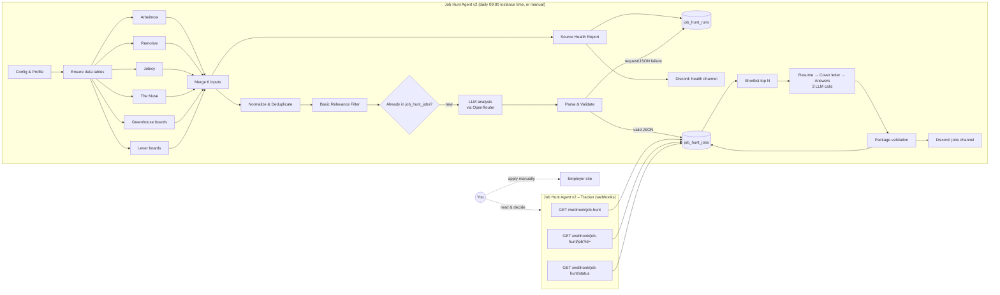

# Job Hunt Agent

A human-in-the-loop job-search agent built on [n8n](https://n8n.io). Once a day it collects job postings from public job-board and company ATS APIs, filters and scores them against your profile with an LLM, checks the model's output against the posting and your profile in code, drafts application materials for the best matches, and sends you a Discord summary. A small web tracker served by n8n lets you review each job and record what you did with it.

**The agent does not apply to jobs.** It finds, ranks and drafts. You read, decide, and submit applications yourself.

> **Status:** personal project, maintained privately. Licensed under the [GNU AGPL v3 or later](#license). Outside contributions are not being accepted for now.

---

## Why

Looking for internships and entry-level roles means checking the same boards every day, skimming lots of postings that are senior, non-software or limited to another country, and rewriting the same cover letter. This project automates the repetitive part and leaves the judgement with you:

- one deduplicated list of new postings from several sources,
- a cheap deterministic filter before any LLM call,
- an LLM relevance analysis whose claims are checked in code against the posting and your profile,
- draft materials that may only use facts from your profile, and are marked `REVIEW_REQUIRED` when they don't,
- a daily source-health report, so "no matching jobs today" is never confused with "the pipeline broke".

## What's in this repository

| Path | Contents |
|---|---|
| `workflows/job-hunt-agent-v2.json` | Main pipeline (47 nodes): fetch → normalize → dedupe → filter → analyze → validate → store → draft package → notify. |
| `workflows/job-hunt-agent-v2-tracker.json` | Tracker (13 nodes): three webhooks that render the stored jobs as HTML pages and save status/notes. |
| `docs/architecture.md` | Node-by-node data flow, data model, validation rules, failure handling. |
| `docs/setup.md` | Installing, configuring and running both workflows. |
| `docs/release-review.md` | Open questions to settle before any public release (API terms, privacy, n8n licensing). |
| `docs/licensing-review.md` | Internal notes on how the license was chosen. Not legal advice. |
| `scripts/sanitize_export.py` | Strips secrets, personal data and instance ids from a fresh n8n export before committing it. |
| `compose.yaml` | Minimal Docker Compose file for a local n8n instance. |

Both workflow files are sanitized exports: the profile is a fictional example, the Discord webhook URLs are empty, credential ids and instance metadata are removed, node and webhook ids are regenerated, and both workflows are inactive on import. They are also a neutral template: no company boards, no workflow timezone, worldwide-remote location defaults, and location scoring based on `profile.location` (see [Settings to review](#settings-to-review-before-the-first-run)).

## Architecture

The two workflows share no code and never call each other. They are linked only by the n8n Data Table `job_hunt_jobs` (the main workflow writes rows, the Tracker reads them and updates `status`/`notes`) and by links: the Discord messages point to Tracker URLs.

See [docs/architecture.md](docs/architecture.md) for the details.

*The diagram shows the main workflow and the Tracker as one system. Any n8n instance with Data Tables can run it; no particular hosting is required.*

## Features (as implemented)

### Job sources

| Source | Integration | Request |
|---|---|---|
| Arbeitnow | Public job-board API, no key | `GET arbeitnow.com/api/job-board-api` |
| Remotive | Public API, no key | `GET remotive.com/api/remote-jobs?category=software-dev` |
| Jobicy | Public API, no key | `GET jobicy.com/api/v2/remote-jobs?count=50&industry=dev` (all regions; add Jobicy's `geo` parameter to narrow it) |
| The Muse | Public API, called **without** an API key | `GET themuse.com/api/public/jobs` filtered to Software Engineering, Internship/Entry Level, `Flexible / Remote`, page 0 (add `&location=City%2C%20Country` parameters for on-site cities) |
| Greenhouse | Public Job Board API, one request per board you add to `config.atsBoards.greenhouse` (empty in the template) | `GET boards-api.greenhouse.io/v1/boards/{board}/jobs?content=true&pay_transparency=true` |
| Lever | Public Postings API, one request per board you add to `config.atsBoards.lever` (empty in the template) | `GET api.lever.co/v0/postings/{board}?mode=json` |

No scraping and no logged-in sessions. Every request sends a descriptive `User-Agent`. The health report also lists sources that are deliberately **not** integrated (LinkedIn, Naukri, Internshala, Indeed, Glassdoor, Unstop, Cutshort, Wellfound, Instahyre: no permitted public API for this setup; Ashby: public API exists but is not configured).

### Source-level failure isolation and health reporting

- Each source is its own `Fetch → Normalize` branch. HTTP nodes retry (3 tries for the four job boards, 2 for the ATS boards, 5 s apart), time out after 30 s, and continue on error.
- Normalize nodes never throw. A timeout, HTTP error, 429, HTML error page, malformed JSON, empty list or parsing bug becomes one `sourceError` item, so that source contributes zero jobs and the others carry on. Greenhouse and Lever report failures per company board.
- `Source Health Report` classifies every source as `SUCCESS`, `FAILED`, `NOT CONFIGURED` or `NOT AVAILABLE`, writes one `source_error` row per failure plus a `run_summary` row to `job_hunt_runs`, and posts the report to a separate Discord health channel **on every run, including runs that find no matching jobs**.
- LLM analysis failures (request errors, invalid JSON) are logged as `analysis_error` rows and the job is **not** stored, so it is retried on the next run.

### LLM analysis and validation

- Model: `google/gemini-3.1-flash-lite` through OpenRouter's chat-completions API (set in `config.model`). Requests force a JSON schema (`response_format: json_schema`) and set `provider.require_parameters: true`; analysis runs at temperature 0, drafting at 0.2, seed 42.
- At most `maxAiJobsPerRun` (10) new jobs are analyzed per run, chosen by a deterministic pre-filter score.
- `Parse & Validate Analysis` treats the model output as untrusted:
  - schema, enum and range checks; any failure makes the job `REVIEW_REQUIRED`, never `SHORTLISTED`;
  - the match score is **recomputed** from the rubric parts (skills 0–40, level 0–25, location 0–20, interest 0–15), never taken from the model;
  - evidence quotes count only if they appear verbatim in the posting;
  - "matching skills" must appear in both the posting and the profile whitelist, so the model cannot add skills to your profile;
  - years-of-experience, salary, remote/on-site and student-eligibility claims are kept only when backed by posting text or source metadata.
- A job is `SHORTLISTED` only if validation passed, it is a software role, the recommendation isn't `skip`, the score is ≥ `minMatchScore` (60) and the skills part is ≥ `minSkillsScore` (15).

### Application package (drafts only)

For up to `maxPackagesPerRun` (5) shortlisted jobs, three sequential LLM calls draft a tailored resume summary/bullets, a cover letter and answers to the questions in `config.applicationQuestions`. The rest of the resume is rendered in code straight from the profile. `Assemble Package` then checks the model-written text for formatting leaks, technologies not in the profile, technologies attached to the wrong project, and invented years, seniority, availability, compensation, work authorization, language or education claims. Any issue sets the job to `REVIEW_REQUIRED` and writes `CHECK:` lines into its notes; only clean packages are announced in Discord as ready.

### Storage and notifications

- n8n **Data Tables** `job_hunt_jobs` (one row per job: metadata, analysis, score breakdown, drafts, status, notes) and `job_hunt_runs` (health and failure log). Both are created on first run.
- Discord: a jobs channel (one header message plus one message per ready package) and a health channel (one report per run). Each is skipped when its webhook URL is empty.

### Tracker

A read/write HTML view of `job_hunt_jobs`, served from n8n webhooks:

- `/webhook/job-hunt`: all jobs sorted by match score, filterable by status (`?status=SHORTLISTED`).
- `/webhook/job-hunt/job?id=<row id>`: job detail with analysis, validation notes and the drafted resume, cover letter and answers (with copy buttons), plus a status/notes form.
- `/webhook/job-hunt/status`: validates and saves a status (`DISCOVERED`, `ANALYZED`, `SHORTLISTED`, `REVIEW_REQUIRED`, `APPLIED`, `REJECTED`, `INTERVIEW`, `OFFER`, `IGNORED`) and notes, then redirects back. System-written `CHECK:` lines are kept when a `REVIEW_REQUIRED` job is saved.

Marking a job `APPLIED` only records what you did. Nothing is sent anywhere.

## Setup (summary)

Full instructions, including credentials and configuration: [docs/setup.md](docs/setup.md).

1. Run n8n (developed against n8n **2.40.7**; Data Tables are required). `compose.yaml` starts a local instance.
2. Create an n8n **Header Auth** credential with `Authorization: Bearer <OpenRouter API key>`.
3. Import both files from `workflows/`, select the credential in the four LLM nodes.
4. Edit `Config & Profile` (see the checklist below).
5. Run the main workflow manually once (this creates the Data Tables), then activate the Tracker and open `/webhook/job-hunt`. **Protect all three Tracker webhooks before n8n is reachable from any other machine.** Finally activate the main workflow for the daily schedule.

### Settings to review before the first run

The template ships with neutral defaults that will run, but they are not tuned for anyone:

| Setting | Where | Template default |
|---|---|---|
| Timezone of the daily 09:00 run | `GENERIC_TIMEZONE` / `TZ` in `compose.yaml` (or your host's environment); optional per-workflow override in n8n's workflow **Settings → Timezone** | `UTC` |
| Your country | `profile.location` in `Config & Profile` (used for location scoring in the analysis prompt) | `Example Country` |
| Remote regions you can work from | `config.locationPolicy.acceptedRemoteRegions` | `worldwide`, `anywhere`, `global` |
| On-site / hybrid locations | `config.locationPolicy.acceptedLocations` | empty, so **all on-site jobs are dropped** |
| Source location filters | URLs of **Fetch The Muse Jobs** and **Fetch Jobicy Jobs** | The Muse: remote only; Jobicy: all regions |
| Company boards | `config.atsBoards.greenhouse` / `.lever` | empty, so both are reported `NOT CONFIGURED` |
| Your profile | `profile` in `Config & Profile` | fictional example; replace every value |
| Discord | `config.discord.*WebhookUrl` | empty (no messages sent) |
| Tracker links | `config.trackerBaseUrl` and three Tracker Code nodes | `http://localhost:5678/webhook/job-hunt` |

There is no `.env` file: configuration lives in the `Config & Profile` Code node and the only secret (the OpenRouter key) lives in n8n's credential store. The Discord webhook URLs are also secrets; see [Privacy and security](#privacy-and-security).

## Cost and performance

There are no measurements from scheduled production runs yet. The figures below come from a standalone comparison harness (2026-10-01) that sent the workflow's own prompts and JSON schemas for **5 real postings** through all four LLM stages (analysis, resume, cover letter, answers), 20 calls per model:

| Model | Calls OK / schema-valid | Total latency | Per job (4 stages) | Total cost (OpenRouter `usage.cost`) | Per job |
|---|---|---|---|---|---|
| `google/gemini-3.1-flash-lite` (used) | 20 / 20 | 84.1 s | 13.1–22.7 s | USD 0.0263 | USD 0.0048–0.0057 |
| `deepseek/deepseek-v4-flash` | 20 / 20 | 578.9 s | 97.9–135.9 s | USD 0.0026 | USD 0.0003–0.0007 |
| `openai/gpt-oss-120b` | 14 attempted, 12 schema-valid | 324.1 s | 27.8–34.4 s (complete jobs) | USD 0.0051 | USD 0.0011–0.0013 |
| `qwen3:4b` (local, via Ollama) | 20 / 20 | 738.9 s | 103.6–179.3 s | 0 (local hardware) | 0 |

Caveats: five postings is a small sample; the harness used `max_tokens: 4000` while the workflow uses 1400; hosted latency depends on which provider OpenRouter routes to; local Qwen latency is not comparable with network calls; output quality is not scored in this table. Gemini was chosen for the latency/cost trade-off on this workload. As an upper bound per run, the configured caps allow at most 10 analysis calls and 15 drafting calls (5 packages × 3).

## Limitations

- **Tracker has no authentication.** Its webhooks are open to anyone who can reach the n8n instance and know the URL, and status changes use `GET`. Keep n8n private, or protect all three Tracker webhooks before n8n is reachable from other machines, and never put credentials in Tracker links or pages (see [setup](docs/setup.md#protect-the-tracker)).
- **Hard-coded tracker base URL.** `http://localhost:5678/webhook/job-hunt` is written in `Config & Profile` (`trackerBaseUrl`) and in three Tracker Code nodes; all four must be edited for any other host.
- The Muse is called without an API key; The Muse's developer docs say registration is required for use beyond testing.
- Only page 0 of The Muse and the first 50 Jobicy results are fetched; no pagination.
- The prompts, filters and validators are written for a student looking for internships and entry-level roles. Location scoring follows `profile.location`, but the region keywords in `locationPolicy` and the source URLs must be adapted by hand (see [setup](docs/setup.md#4-configure-config--profile)).
- The profile is a JavaScript object inside a Code node, not a separate file, and must be kept in sync by hand. The Tracker's `PROFILE_UPDATED_AT` constant (used to label older rows "historical") must also be updated by hand.
- Some code comments, the in-workflow sticky note and the request field name `ollamaRequest` still refer to Ollama/Qwen3 from an earlier version of the workflow. These are naming leftovers; the HTTP nodes call OpenRouter.
- n8n's Data Table "create if not exists" matches table names by substring, so a newer table whose name *contains* `job_hunt_jobs` or `job_hunt_runs` (e.g. `job_hunt_jobs_test`) can be picked up instead. Both `Ensure` nodes continue on error to tolerate this, but avoid such names on the same instance.
- No automated tests are included in this repository.

## Privacy and security

- Your profile, generated documents and job history are personal data. They live in your n8n instance's Data Tables and execution logs (the workflows save data for all executions), and profile data is sent to OpenRouter and the upstream model provider: a subset (education status, location, roles, skills, projects, experience) for analysis, and the full profile, including contact details, for drafting packages.
- Discord webhook URLs grant posting rights to a channel; treat them like passwords.
- Never commit a raw n8n export. Run `scripts/sanitize_export.py` with a private deny-list file first (see [setup](docs/setup.md#updating-the-exports-in-this-repository)).
- Remotive and Jobicy require attribution and a link to the original posting when listings are shown; the Discord messages and the Tracker include the source name and URL. Review [docs/release-review.md](docs/release-review.md) before showing listings to anyone else.

## Human in the loop

The agent prepares and prioritizes. It never submits an application, fills an employer form, or contacts an employer. Every draft is a starting point to check against the posting and your own facts before you use it.

## Contributing

This repository is private and is not accepting outside contributions for now.

## License

Copyright (C) 2026 Minit Jain

This project (the workflow files, scripts and documentation) is licensed under the **GNU Affero General Public License v3.0 or later** (`AGPL-3.0-or-later`). See [LICENSE](LICENSE) for the full text.

In plain words, and not a substitute for the license itself:

- You may use, study, change and share this project, including for commercial purposes.
- If you share a copy, changed or not, you must keep the copyright and license notices and make its source available under the same license.
- If you run a changed version as a service that other people use over a network, you must offer those users its source under the same license.

The license covers only this repository. n8n, which runs the workflows, has its own license (the [Sustainable Use License](https://github.com/n8n-io/n8n/blob/master/LICENSE.md)), and the job sources and LLM provider have their own terms.
