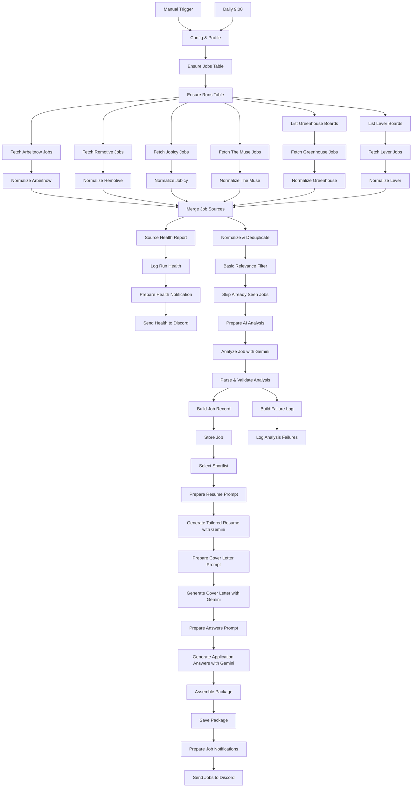
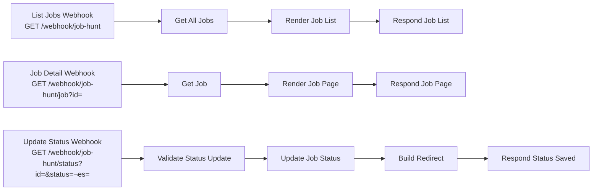
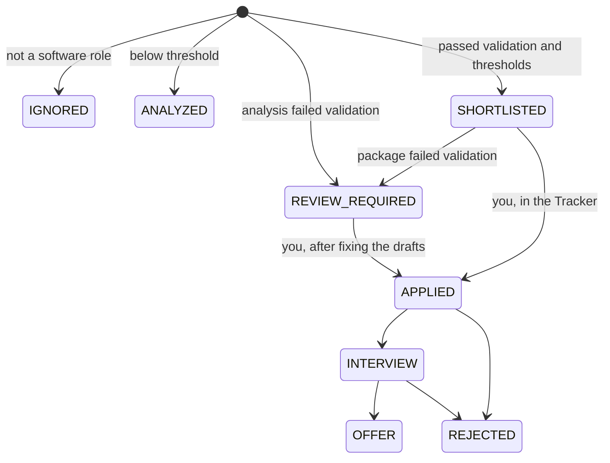

# Architecture

This document describes the two workflows in `workflows/` as they are implemented. Node names are given in **bold** so they can be found in the n8n editor.

## Overview

| Workflow | Trigger | Purpose |
|---|---|---|
| Job Hunt Agent v2 | **Daily 9:00** (schedule, 09:00 in the n8n instance timezone `GENERIC_TIMEZONE`) and **Manual Trigger** | Collect, filter, analyze, store, draft, notify |
| Job Hunt Agent v2 – Tracker | Three webhooks | Browse stored jobs, read drafts, record status and notes |

The workflows do not call each other. They share the Data Table `job_hunt_jobs`.

## Main workflow

### 1. Configuration

**Config & Profile** (Code) returns one item holding `config`, `profile`, a flat `skillList`, a `skillWhitelist` (declared skills plus the tech of your own projects) and `projectTech` (allowed technologies per project), plus `runStartedAt`. Every later node reads it through `$('Config & Profile')`.

Key `config` fields:

| Field | Default in export | Used by |
|---|---|---|
| `model` | `google/gemini-3.1-flash-lite` | all four LLM requests |
| `maxAiJobsPerRun` | 10 | Prepare AI Analysis |
| `maxPackagesPerRun` | 5 | Select Shortlist |
| `minMatchScore` / `minSkillsScore` | 60 / 15 | Parse & Validate Analysis |
| `maxYearsExperience` | 3 | Basic Relevance Filter, validation |
| `locationPolicy` | remote regions `worldwide`, `anywhere`, `global`; no on-site locations | Basic Relevance Filter |
| `atsBoards.greenhouse` / `atsBoards.lever` | empty (both sources report NOT CONFIGURED until you add boards) | List … Boards |
| `discord.jobsWebhookUrl` / `discord.healthWebhookUrl` | empty | notifications (skipped when empty) |
| `trackerBaseUrl` | `http://localhost:5678/webhook/job-hunt` | links in Discord messages |
| `applicationQuestions` | four generic questions | Prepare Answers Prompt |

**Ensure Jobs Table** and **Ensure Runs Table** create the two Data Tables if they don't exist. Both continue on error (see the substring caveat in the README limitations).

### 2. Collection and fault isolation

Every source is an independent branch that always produces at least one item:

- **Fetch …** (HTTP Request): 30 s timeout, retry on fail, *On Error: continue (regular output)*. Greenhouse and Lever send one request per configured board.
- **Normalize …** (Code): maps the response to a common shape (`_kind: 'job'`) or, on any failure, emits a `_kind: 'sourceError'` item with a short reason (`HTTP 429 …`, `timeout: …`, `network error: …`, `Malformed JSON`, `Empty response (0 jobs)`, `Parsing error: …`). The whole node body is wrapped so it never throws. ATS normalizers attribute failures to the individual board via `pairedItem`, and emit `sourceNotConfigured` when no boards are listed.
- **Merge Job Sources** (6 inputs) waits for all six branches. Because each branch always emits something, one failing source can't stall or stop the run.

### 3. Source health

**Source Health Report** keeps a registry of known sources with a state (`active`, `not_configured`, `not_available`) and derives a status per source:

| Status | Meaning |
|---|---|
| `SUCCESS` | at least one job; for ATS sources, failed boards are listed alongside |
| `FAILED` | no jobs and an error (or no output at all) |
| `NOT CONFIGURED` | public API exists but isn't set up (Ashby), or no boards configured |
| `NOT AVAILABLE` | no permitted API for this setup; never scraped |

It outputs one `source_error` row per failure and one `run_summary` row (the human-readable report plus JSON details: jobs per source, sources OK/active, statuses). **Log Run Health** appends them to `job_hunt_runs`; **Prepare Health Notification** and **Send Health to Discord** post the report every run. This branch runs regardless of how many jobs survive filtering, which is what separates a quiet day ("Jobs collected: N, Sources succeeded: 6/6", then no jobs message) from a broken pipeline (❌ lines in the report).

### 4. Normalization, deduplication and filtering

**Normalize & Deduplicate** converts HTML to text, parses employer-published salary only (structured fields or a pay statement found in text with pay context nearby; never estimated), extracts an application URL only when the posting links to an ATS/apply page, infers seniority and minimum years from text, and builds `jobKey = company|title|location` (normalized). Duplicates are matched by source id, then application URL, then `jobKey`; merged jobs keep a `sources` list.

**Basic Relevance Filter** drops only obvious mismatches: non-software titles, senior titles (unless the posting is internship/junior), no software keyword (unless the source was queried by software category), more than `maxYearsExperience` required years, and locations outside the policy. "Working student / Werkstudent" roles are kept but flagged for an eligibility check. Kept jobs get a `prefilterScore` (skill hits, level bonus, title match, disclosed salary) used only for ordering. Drop counts per reason are carried in `pipelineStats`.

**Skip Already Seen Jobs** keeps only jobs whose `jobKey` is not yet in `job_hunt_jobs`.

### 5. LLM analysis

**Prepare AI Analysis** sorts by `prefilterScore`, keeps the top `maxAiJobsPerRun`, and builds a chat request with a JSON schema (role type, seniority, required/matching/missing skills, gaps, location/remote fit, four rubric sub-scores, reasons, compensation and evidence quotes, student eligibility, recommendation, confidence). The prompt includes a subset of the profile (no contact details) and tells the model to use only the posting and the profile.

**Analyze Job with Gemini** sends it to `https://openrouter.ai/api/v1/chat/completions` with `response_format: json_schema` (strict: false), `provider.require_parameters: true`, reasoning disabled, `max_tokens` 1400, temperature 0, seed 42; one job at a time, 2 tries, 900 s timeout, continue on error.

### 6. Deterministic validation

**Parse & Validate Analysis** runs per item and returns `ok: false` (request failure or unparseable JSON) or `ok: true` with a status.

Blocking checks (any failure → `REVIEW_REQUIRED`):
- `isSoftwareRole` is boolean; `seniority`, `locationFit`, `remoteFit`, `recommendation` are in their enums;
- each sub-score is an integer in range; list fields are lists; `confidence` is 0–1; required objects are present.

Normalizing checks (claim removed or downgraded, recorded in `scoreBreakdown.validation.normalized`):
- evidence quotes must appear verbatim (ignoring case and punctuation) in the posting;
- years of experience only from posting text;
- compensation only from source fields or a verbatim posting quote; bonus/equity are scanned for deterministically;
- `matchingSkills` must appear in both the posting and `skillWhitelist`; `why` bullets crediting a non-profile skill are dropped;
- remote/hybrid/on-site needs source metadata or posting text;
- working-student eligibility needs a verified quote.

The match score is recomputed from the sub-scores (plus caps), never taken from the model. `matchLevel`: ≥ 80 strong, ≥ 65 good, ≥ 50 fair, else weak.

Status: `REVIEW_REQUIRED` if validation failed; else `SHORTLISTED` if software role, recommendation ≠ skip, score ≥ `minMatchScore`, skills ≥ `minSkillsScore` and (if flagged) student eligibility confirmed; else `ANALYZED` (software) or `IGNORED`.

**Build Job Record → Store Job** upserts `ok` items by `jobKey`. **Build Failure Log → Log Analysis Failures** writes `analysis_error` rows; failed jobs are not stored and are retried next run.

### 7. Application package

**Select Shortlist** takes `SHORTLISTED` rows whose stored validation passed, sorted by score, top `maxPackagesPerRun`. For each, three prompt/LLM pairs run in sequence (resume, cover letter, answers), each forced into a JSON schema with a single `document` field, temperature 0.2. The prompts carry the full profile, verified matching skills, and the job's missing skills labelled "never claim these".

**Assemble Package** renders the resume Markdown from the profile and inserts the model-written summary/bullets, then validates all model-written text:
1–2. rendering/format leaks;
3. technologies not in the profile (a hedged "eager to learn X" is allowed);
4. a sentence naming a project may only attach that project's technologies;
5–9. invented years, seniority, availability, compensation, experience, work authorization, language, education;
10. answers the model could not ground.

Any issue → `REVIEW_REQUIRED` with `CHECK:` lines in `notes`; generation errors add `GENERATION ERROR:` lines. **Save Package** updates the row by id.

### 8. Notifications

**Prepare Job Notifications** sends nothing if the jobs webhook is empty or no package was produced. Otherwise: a header (ready count, analyzed, shortlisted, how many need review, tracker link) and one message per ready package (title, company, compensation, location, remote, score, reasons, gaps, application or listing URL, source attribution, tracker link). `REVIEW_REQUIRED` packages are counted, not announced. Messages are capped at 1990 characters and sent 1.5 s apart.

## Tracker workflow

- **Render Job List**: HTML table sorted by score with status tabs; rows discovered before `PROFILE_UPDATED_AT` are labelled "historical". All values are HTML-escaped.
- **Render Job Page**: details, score breakdown and validation notes, drafted documents with copy buttons, and a `GET` form for status and notes. For `REVIEW_REQUIRED` rows, the system `CHECK:` lines travel in a hidden field.
- **Validate Status Update**: allows only the nine known statuses and an integer id (throws otherwise), keeps `CHECK:`/`GENERATION ERROR:` lines for `REVIEW_REQUIRED`, truncates notes to 2000 characters, stamps `statusUpdatedAt`.
- **Build Redirect**: meta-refresh back to the job page.

The base URL `http://localhost:5678/webhook/job-hunt` is hard-coded in Render Job List, Render Job Page and Build Redirect. None of the webhooks has authentication.

## Data model

### `job_hunt_jobs`

One row per job, keyed by `jobKey`. Columns: `jobKey`, `status`, `title`, `company`, `location`, `remote`, `remoteRegions`, `employmentType`, `seniority`, `source`, `sources` (JSON), `sourceUrl`, `applicationUrl`, `postedAt`, `discoveredAt`, `salaryRaw`, `salaryMin`, `salaryMax`, `salaryCurrency`, `salaryPeriod`, `salaryDisclosed`, `salaryNote`, `matchScore`, `matchLevel`, `recommendation`, `confidence`, `scoreBreakdown` (JSON incl. validation and evidence), `why`, `matchingSkills`, `missingSkills`, `experienceGap`, `experienceRequired`, `languageRequirement`, `description`, `resume`, `coverLetter`, `answers`, `packageGeneratedAt`, `notes`, `statusUpdatedAt`.

### `job_hunt_runs`

Append-only log: `runAt`, `kind` (`run_summary`, `source_error`, `analysis_error`), `source`, `message`, `details`.

### Status lifecycle

All transitions after the first are manual. The Tracker allows any status to be set; the diagram shows the intended use. `DISCOVERED` is accepted by the Tracker but the main workflow never writes it.

## External dependencies

| Dependency | Role | Notes |
|---|---|---|
| n8n (self-hosted) | runtime | Core nodes only: Code, HTTP Request, Data Table, Merge, Schedule, Manual, Webhook, Respond to Webhook, Sticky Note. No community nodes. |
| OpenRouter | LLM gateway | one Header Auth credential |
| Google Gemini 3.1 Flash Lite (via OpenRouter) | model | changeable in `config.model` |
| Arbeitnow, Remotive, Jobicy, The Muse | job boards | public HTTP APIs, no keys |
| Greenhouse Job Board API, Lever Postings API | company ATS boards | public, per-company |
| Discord | notifications | two incoming webhooks, optional |
